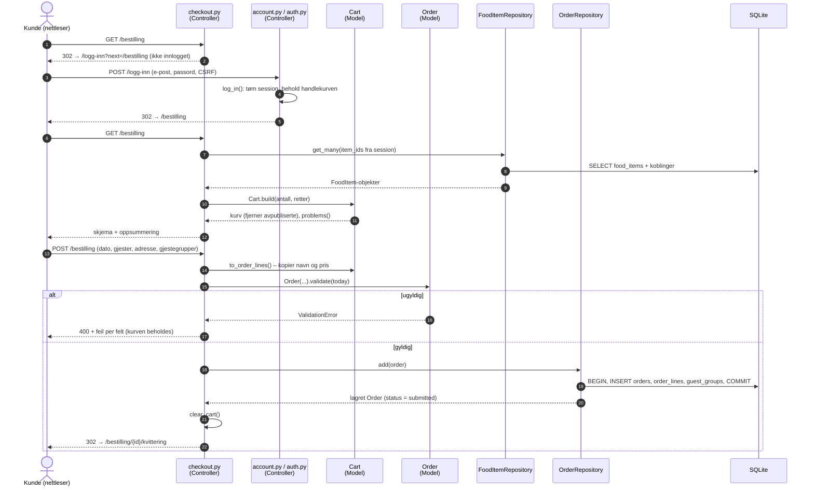

# Sekvensdiagram: kunden sender en bestilling (C3)

Viser flyten fra «Gå til bestilling» i handlekurven til kvitteringen, inkludert innlogging
midt i flyten.

Diagrammet er tegnet etter at koden var skrevet. Det viser to valg som ble tatt i plan 05 og plan 02:
- Innlogging tømmer sessionen for å hindre session fixation. Uten unntak ville kunden mistet
  handlekurven i trinn 4, så `log_in()` beholder den.
- Ordre, linjer og gjestegrupper lagres i **én transaksjon**, slik at en halv ordre aldri blir
  liggende i databasen (`test_order_with_invalid_line_rolls_back`).
