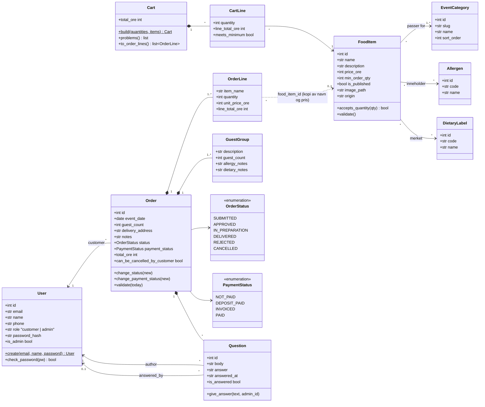

# Domenemodell (klassediagram)

Klassene finnes i `app/models/`. Priser er i øre (heltall). `Cart` lagres ikke i databasen,
men i sessionen, og gjøres om til `OrderLine`-er ved bestilling.

## Valg som diagrammet viser

- `OrderLine` **kopierer** navn og pris. Når admin endrer eller sletter en rett, endres ikke
  eksisterende ordrer (`food_item_id` blir `NULL` ved sletting).
- `GuestGroup` holder allergier per gruppe og ikke per navngitt gjest (GDPR art. 9 i datapakken).
- Ordrestatus og betalingsstatus er **uavhengige**. Ordrestatus følger tilstandsmaskinen i
  [ordrestatus.md](ordrestatus.md), mens betalingsstatus kan settes fritt av admin.
