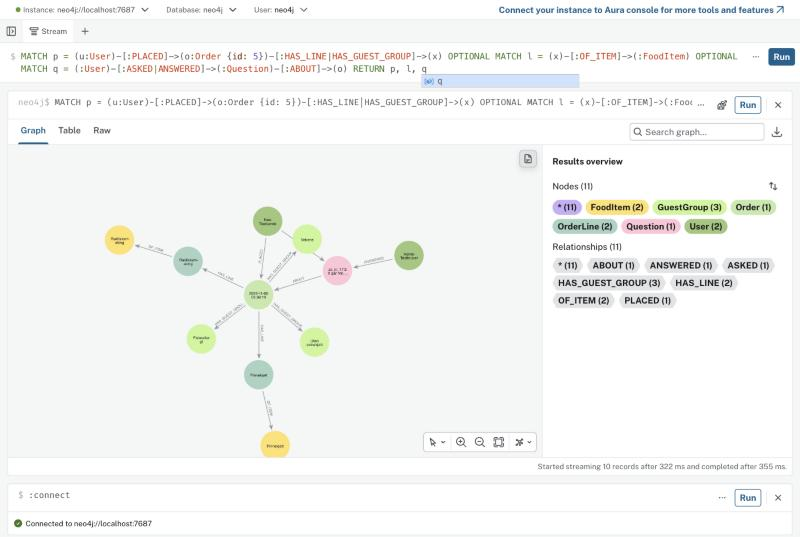
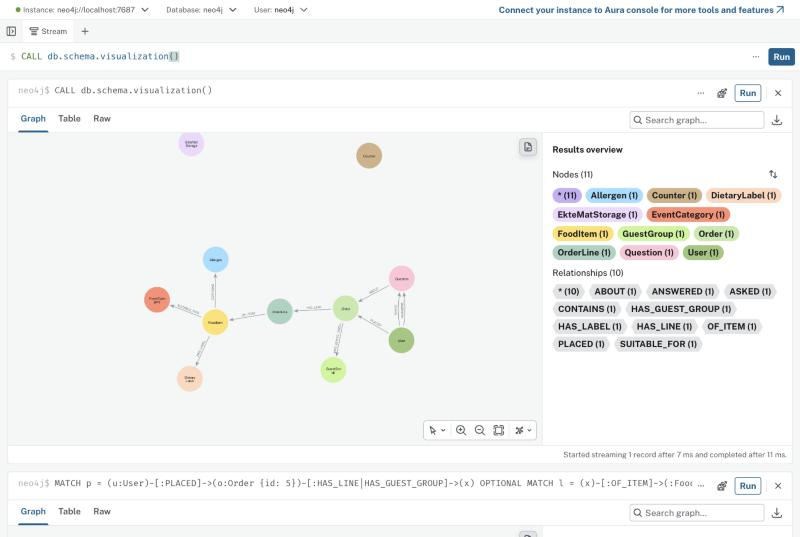

# Grafdatamodell (Neo4j, Oblig 5)

Når `STORAGE_BACKEND=neo4j`, lagres domenet som en property graph i Neo4j 5.26. Modellen er
implementert i `app/models/repositories/neo4j/`. Den er den samme som i
[plan 10](../plans/10-neo4j.md) og samsvarer med `db.schema.visualization()` i Neo4j Browser
(skjermbildet nederst).

```mermaid
flowchart LR
    User(["User<br/>id · email · name · role<br/>password_hash · created_at"])
    Order(["Order<br/>id · event_date (date) · guest_count<br/>delivery_address · notes · status<br/>payment_status · estimated_total_ore"])
    OrderLine(["OrderLine<br/>id · item_name · quantity<br/>unit_price_ore"])
    GuestGroup(["GuestGroup<br/>id · description · guest_count<br/>allergy_notes · dietary_notes"])
    Question(["Question<br/>id · body · created_at<br/>answer · answered_at"])
    FoodItem(["FoodItem<br/>id · name · description · price_ore<br/>min_order_qty · origin · image_path<br/>is_published"])
    EventCategory(["EventCategory<br/>id · slug · name · sort_order"])
    Allergen(["Allergen<br/>id · code · name"])
    DietaryLabel(["DietaryLabel<br/>id · code · name"])

    User -- PLACED --> Order
    Order -- HAS_LINE --> OrderLine
    OrderLine -- "OF_ITEM (0..1)" --> FoodItem
    Order -- HAS_GUEST_GROUP --> GuestGroup
    User -- ASKED --> Question
    Question -- ABOUT --> Order
    User -- "ANSWERED (admin)" --> Question
    FoodItem -- SUITABLE_FOR --> EventCategory
    FoodItem -- CONTAINS --> Allergen
    FoodItem -- HAS_LABEL --> DietaryLabel
```



Hjelpenoder som ikke er en del av domenet:
- `(:Counter {name, value})` gir heltalls-ID-er per label. Neo4js egne `elementId` er ikke stabile heltall,
  men URL-ene og domeneklassene bruker heltall.
- `(:EkteMatStorage {app, schema_version})` er en markørnode. `reset` og `init-db` nekter å tømme en
  database som har data, men mangler denne noden.

## Fra tabeller til graf

| SQLite | Neo4j | Kommentar |
|---|---|---|
| `users`, `orders`, `food_items` … | Noder med label `User`, `Order`, `FoodItem` … | Samme felt og samme heltalls-ID-er |
| `orders.customer_id` (fremmednøkkel) | `(:User)-[:PLACED]->(:Order)` | Fremmednøkler blir relasjoner |
| `food_item_categories` / `_allergens` / `_dietary_labels` (koblingstabeller) | `SUITABLE_FOR`, `CONTAINS`, `HAS_LABEL` | Mange-til-mange-tabellene forsvinner |
| `order_lines.food_item_id ON DELETE SET NULL` | `OF_ITEM` forsvinner ved `DETACH DELETE` | Ordrelinjen beholder navn og pris |
| `questions.author_id` / `answered_by` | `ASKED` / `ANSWERED` | Hvem som svarte, er en relasjon og ikke en kolonne |
| `UNIQUE` | `CREATE CONSTRAINT … IS UNIQUE` | id per label, `User.email`, `EventCategory.slug`, koder |
| `CHECK (status IN …)`, `price_ore >= 0` … | Domeneklassene (`Order.change_status`, `validate()`) | Neo4j Community har ikke CHECK |
| Transaksjon (`with db:`) | `session.execute_write(...)` | Ordre, linjer og gjestegrupper lagres atomisk |
| `event_date TEXT` | `event_date` som Neo4j `date` | Datofiltrene i A3 sammenligner datoer, ikke tekst |

## Eksempler på spørringer

Spørringene leser bare. De kan kjøres i Neo4j Browser (http://localhost:7474).

```cypher
// Ordre 5 med kunde, retter, gjestegrupper og spørsmål (skjermbilde 12)
MATCH p = (u:User)-[:PLACED]->(o:Order {id: 5})-[:HAS_LINE|HAS_GUEST_GROUP]->(x)
OPTIONAL MATCH l = (x)-[:OF_ITEM]->(:FoodItem)
OPTIONAL MATCH q = (:User)-[:ASKED|ANSWERED]->(:Question)-[:ABOUT]->(o)
RETURN p, l, q

// Grafmodellen slik databasen selv ser den (skjermbilde 13)
CALL db.schema.visualization()

// Kjøkkenet: allergier per gjestegruppe for godkjente ordrer de neste 14 dagene
MATCH (o:Order {status: 'approved'})-[:HAS_GUEST_GROUP]->(g:GuestGroup)
WHERE o.event_date <= date() + duration('P14D') AND g.allergy_notes <> ''
RETURN o.id, o.event_date, g.description, g.guest_count, g.allergy_notes
ORDER BY o.event_date

// Hvilke retter med nøtter er bestilt, og av hvem?
MATCH (u:User)-[:PLACED]->(:Order)-[:HAS_LINE]->(:OrderLine)-[:OF_ITEM]->(f:FoodItem)-[:CONTAINS]->(:Allergen {code: 'nuts'})
RETURN DISTINCT f.name, u.name
```

De to siste viser hvorfor grafen passer: spørsmål som går over flere ledd (kunde → ordre →
linje → rett → allergen) blir ett mønster i stedet for fire JOIN-er.

## Skjermbilder fra Neo4j Browser

**Ordre 5** fra nettlesertesten i fase N4: kunden og admin, ordren, to ordrelinjer koblet til rettene,
tre gjestegrupper og et besvart spørsmål. Det er 11 noder og 11 relasjoner.



**`db.schema.visualization()`** viser 11 node-typer og 10 relasjonstyper, nøyaktig som modellen over.
`Counter` og `EkteMatStorage` står frakoblet, som de skal.


