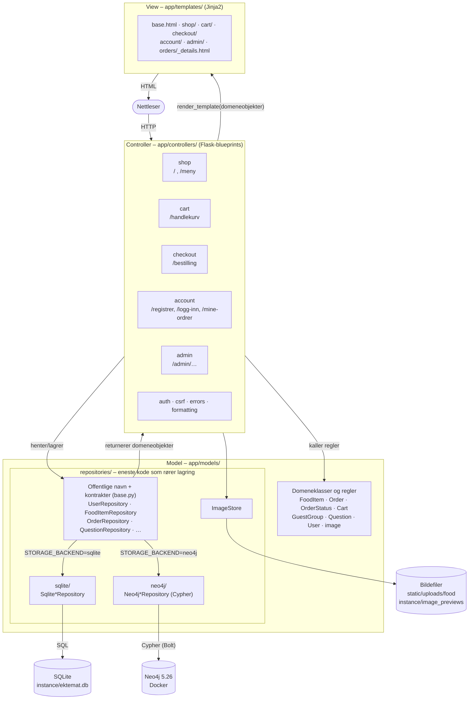

# MVC-arkitektur

## Regler mellom lagene

| Regel | Hvorfor | Sjekket av |
|---|---|---|
| Bare `repositories/sqlite/` bruker SQLite, og bare `repositories/neo4j/` bruker Neo4j | Lagringen kan byttes uten endringer i controllere og views. Det skjedde i Oblig 5: `git diff oblig4 -- app/controllers app/templates` er tom | `tests/test_architecture.py` |
| Controllerne importerer bare de offentlige navnene (`FoodItemRepository` …), aldri en bestemt lagring | `backend.py` velger implementasjon ut fra `STORAGE_BACKEND` | `tests/test_architecture.py`, `tests/test_storage_backend.py` |
| Begge lagringene oppfyller de samme kontraktene (`base.py`) | Samme oppførsel uansett lagring | Kontrakttestene i `tests/test_repositories.py` (mot begge) |
| Repositories returnerer domeneobjekter, aldri `sqlite3.Row` | Viewene er uavhengige av lagringen | Kodegjennomgang og repository-testene |
| Forretningsregler ligger i domeneklassene, ikke i controllerne | Reglene kan testes uten Flask (`tests/test_domain.py`, `tests/test_cart.py`) | `Order.change_status`, `Cart.problems`, `check_quantity` |
| Controllerne er tynne: de leser forespørselen, kaller modellen og velger view | Lett å lese og teste | Rutetestene |
| Handlekurven ligger i Flask-session, ikke i databasen | Den er nettleserdata og ikke forretningsdata. Den blir en ordre ved bestilling | `app/controllers/cart.py` |
