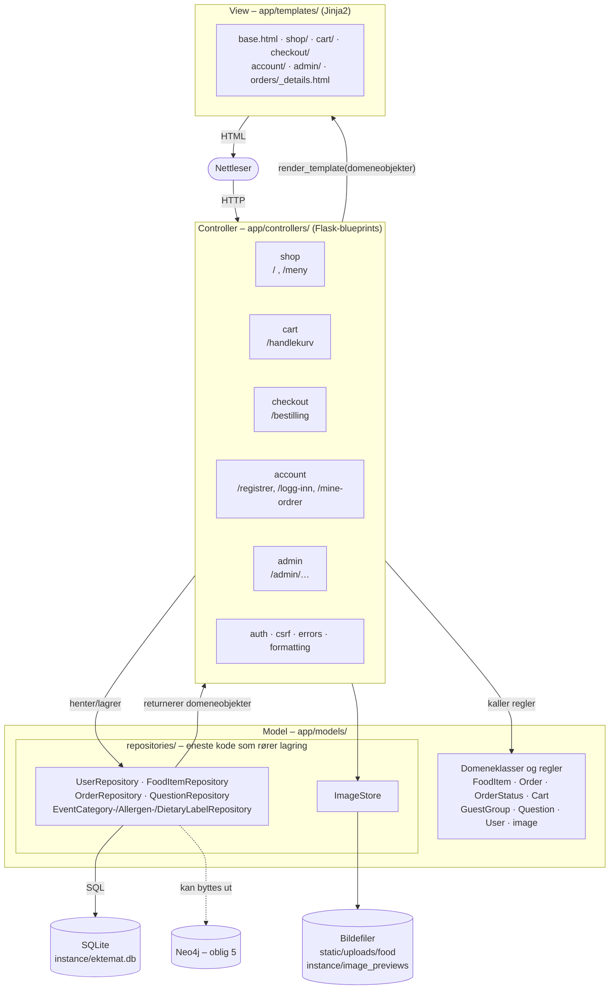

# MVC-arkitektur

## Regler mellom lagene

| Regel | Hvorfor | Sjekket av |
|---|---|---|
| Bare `app/models/repositories/` importerer `sqlite3` eller skriver SQL | Neo4j skal kunne erstatte SQLite uten endringer i controllere og views | `tests/test_architecture.py` |
| Repositories returnerer domeneobjekter, aldri `sqlite3.Row` | Viewene er uavhengige av lagringen | Kodegjennomgang og repository-testene |
| Forretningsregler ligger i domeneklassene, ikke i controllerne | Reglene kan testes uten Flask (`tests/test_domain.py`, `tests/test_cart.py`) | `Order.change_status`, `Cart.problems`, `check_quantity` |
| Controllerne er tynne: de leser forespørselen, kaller modellen og velger view | Lett å lese og teste | Rutetestene |
| Handlekurven ligger i Flask-session, ikke i databasen | Den er nettleserdata og ikke forretningsdata. Den blir en ordre ved bestilling | `app/controllers/cart.py` |
