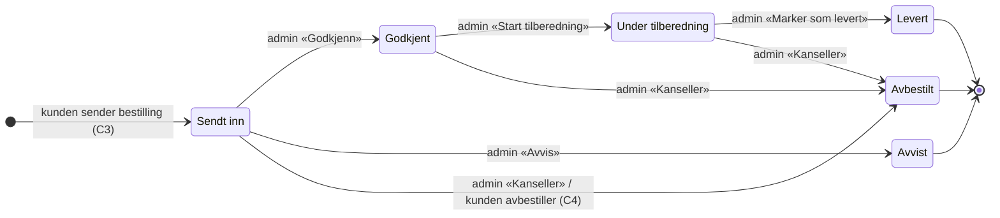

# Tilstandsmaskin for ordrestatus (A3)

Implementert som `ALLOWED_TRANSITIONS` i `app/models/order.py`. Alle endringer går gjennom
`Order.change_status()`. En ulovlig overgang gir `InvalidStatusTransition` og endrer ikke ordren.

| Regel | Hvor den håndheves |
|---|---|
| Bare pilene over er lovlige | `Order.change_status()` og `tests/test_domain.py` |
| Admin ser bare knapper for lovlige overganger | `Order.allowed_next_statuses()` i `admin/order_detail.html` |
| Kunden kan bare avbestille fra «Sendt inn» | `Order.can_be_cancelled_by_customer` og `tests/test_my_orders.py` |
| «Avvis» og «Kanseller» krever bekreftelse | `OrderStatus.needs_confirmation` |
| Lovlige verdier er sikret i databasen | `CHECK (status IN (...))` i `schema.sql` |

Betalingsstatus (`not_paid → deposit_paid → invoiced → paid`) er ikke en tilstandsmaskin.
Datapakken viser at bedrifter faktureres uten depositum mens bryllup betaler depositum,
så admin kan sette betalingsstatus fritt.
