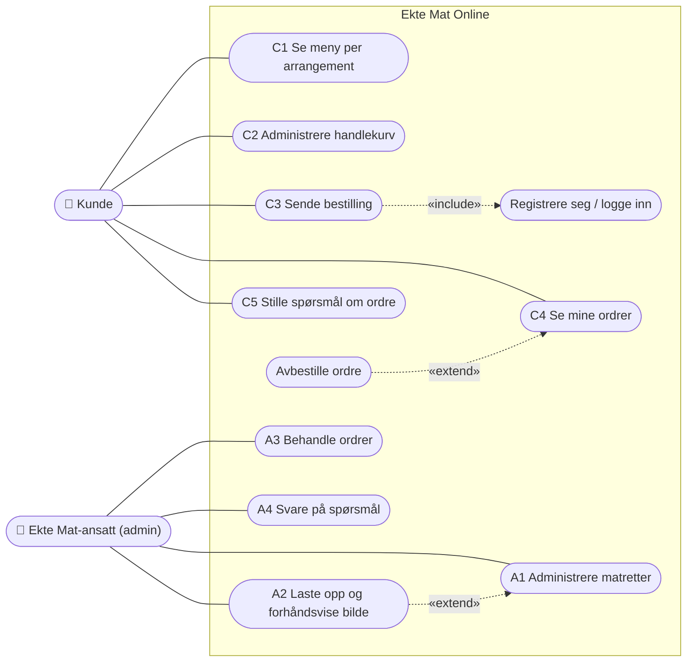

# Use case-diagram

Mermaid har ingen egen diagramtype for use case. Diagrammet er derfor tegnet som en graf,
med aktørene til venstre og systemgrensen som en boks.

- **Kunde:** besøkende kan se menyen og fylle handlekurven uten å logge inn. Bestilling,
  mine ordrer og spørsmål krever innlogging.
- **Admin:** alle admin-brukstilfellene krever rollen `admin`, som `@admin_required` sjekker.
